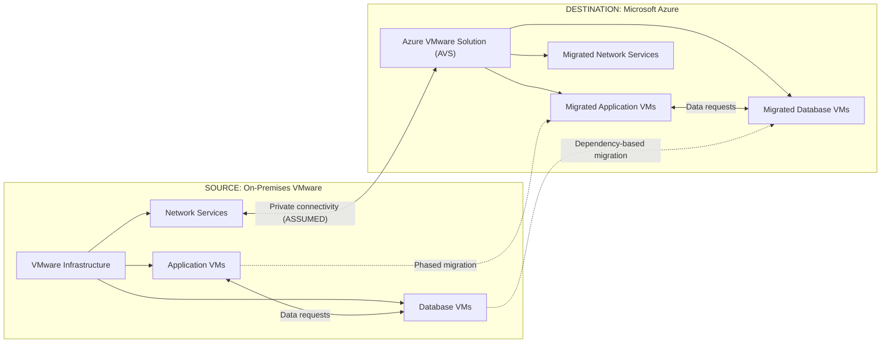

# Lab 5 – Rehosting to Microsoft Azure

**Course:** Cloud Migration (CST8913)  
**Case Study:** Washington State Department of Labor & Industries (L&I)

## 1. Business Drivers and Migration Strategy

The Washington State Department of Labor & Industries had an aging IT environment developed over approximately 45 years. The organization had more than 400 servers and over 200 applications and systems.

Two important reasons for moving to Azure were:

**First, infrastructure modernization.** The existing on-premises systems were becoming difficult to maintain. The organization needed a more stable and modern environment while keeping important public services available.

**Second, cost management.** L&I wanted to reduce operational expenses and make its IT costs more predictable. Moving to Azure provided an opportunity to improve efficiency and long-term financial planning.

### Why Rehosting?

Rehosting was appropriate because L&I already used VMware. Azure VMware Solution (AVS) allowed the organization to migrate its existing virtual machines without significantly modifying the applications.

This approach reduced migration complexity and helped maintain business continuity.

**Rehosting** means moving existing workloads to the cloud with minimal changes.

**Replatforming** means making selected platform changes during migration, such as moving a database from a virtual machine to a managed cloud database service.

Rehosting was a practical first step because L&I could move its workloads first and modernize applications afterward.

## 2. Architecture Diagram

The diagram below illustrates a proposed migration architecture. It separates application workloads, database workloads, and network services to make their dependencies easier to understand.

### Architecture Explanation

The source environment represents the organization's existing on-premises VMware infrastructure.

The destination environment is Azure VMware Solution, where the migrated workloads continue running in a VMware-based environment.

The application and database VMs are represented separately to highlight the importance of workload dependencies. Related workloads should be migrated together or maintain reliable communication during the transition.

### Assumptions

- **Assumption 1:** Application and database VMs are represented as separate groups. The case study does not provide the exact architecture of these workloads.
- **Assumption 2:** Private connectivity is used between the on-premises environment and Azure. The article does not identify the specific connection technology.
- **Assumption 3:** Applications communicate with database servers. These connections illustrate possible dependencies rather than a confirmed L&I architecture.
- **Assumption 4:** Network services are shown in both environments to illustrate the transition. Their exact deployment arrangement is not specified in the case study.

## 3. Migration and Validation Plan

I would migrate the workloads in several controlled waves rather than moving all virtual machines at once.

### Phase 1: Inventory and Dependency Analysis

First, I would identify all virtual machines, applications, databases, and network services.

I would create dependency groups so that applications and their required databases are migrated together when possible.

For example, if an employee application depends on a database, I would include both workloads in the same migration group or verify that communication between them remains available.

### Phase 2: Pilot Migration

I would begin with a small pilot wave of approximately 10 low-risk virtual machines.

This follows the approach described in the case study and allows the migration team to identify technical problems before migrating more important workloads.

### Phase 3: Validation

After the pilot migration, I would verify:

- Virtual machines start successfully.
- Applications can communicate with their databases.
- Network connectivity works correctly.
- Users can access the migrated applications.
- Performance and business functions meet the expected requirements.

The results would be compared with the original on-premises environment.

### Phase 4: Additional Migration Waves

If the pilot is successful, I would continue with larger migration waves.

The case study reports that L&I later migrated approximately 75 virtual machines per wave.

Each wave would group dependent workloads and include validation before proceeding to the next group.

### Phase 5: Proceed or Roll Back

**Proceed:** Continue to the next migration wave when application functionality, database connectivity, network access, and performance tests are successful.

**Rollback:** Stop the migration and restore the previous working environment if a critical application fails, important data becomes inconsistent, or business operations are interrupted.

The team should investigate the problem, correct it, and repeat the tests before attempting the migration again.

### Phase 6: Post-Migration Monitoring

After completing the migration, I would monitor application performance, network connectivity, availability, and cloud costs.

Once the environment is stable, L&I could gradually replatform or refactor selected applications to take greater advantage of Azure services.

## Conclusion

The Washington State Department of Labor & Industries case study demonstrates how rehosting can support a large VMware migration while maintaining business continuity.

A phased migration approach, dependency analysis, validation testing, and a rollback strategy help reduce risk and make the transition more manageable.

## Reference

Microsoft. (2024, August 1). *Washington State Department of Labor & Industries drives cultural shift and achieves measurable cost savings with Microsoft Azure.*

https://www.microsoft.com/en/customers/story/1797135170129986863-lni-azure-vmware-solution-national-government-en-united-states
