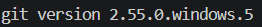

# Lab 1: Git, GitHub, and Markdown Fundamentals
## Student Information
**Full Name:** Justin AROGA
**Student Number:** 041290562
## Introduction
**Git:** Is a tool that allow us to record and track changes in a project.
**GitHub:** Is an online that allow us to store our repositories.
**Markdown:** Is a language that allows us to format and organise text. 
## Git Version
git version 2.55.0.windows.5
## Git and GitHub Workflow
1. I create a private repository on GitHub.
2. I cloned the repository to my computer.
3. I Created a new branch colled lab-01.
4. I created a file named README.md in the lab-01 folder.
5. I used git add to prepare my changes for the commit.
6. I used git commit to record my changes.
## Markdown Demonstration
### Headings
### Text formating
**Git is a version control tool**
*GitHub stores repositories online*
***git is a version control tool***
~~Git stores repositories online~~
### Lists
1. Git
2. GitHub
3. Markdown
- Git
- GitHub
- Markdown
 
 -Git
   - git status
   - git add
### Links
[GitHub](https://github.com)
### Image 

### Blokequote
> Git helps developers track changes in a projet.
### Inline Code 
`Git status` helps us know the status of our files
## Challenges and solutions
## Learning Reflection
## References